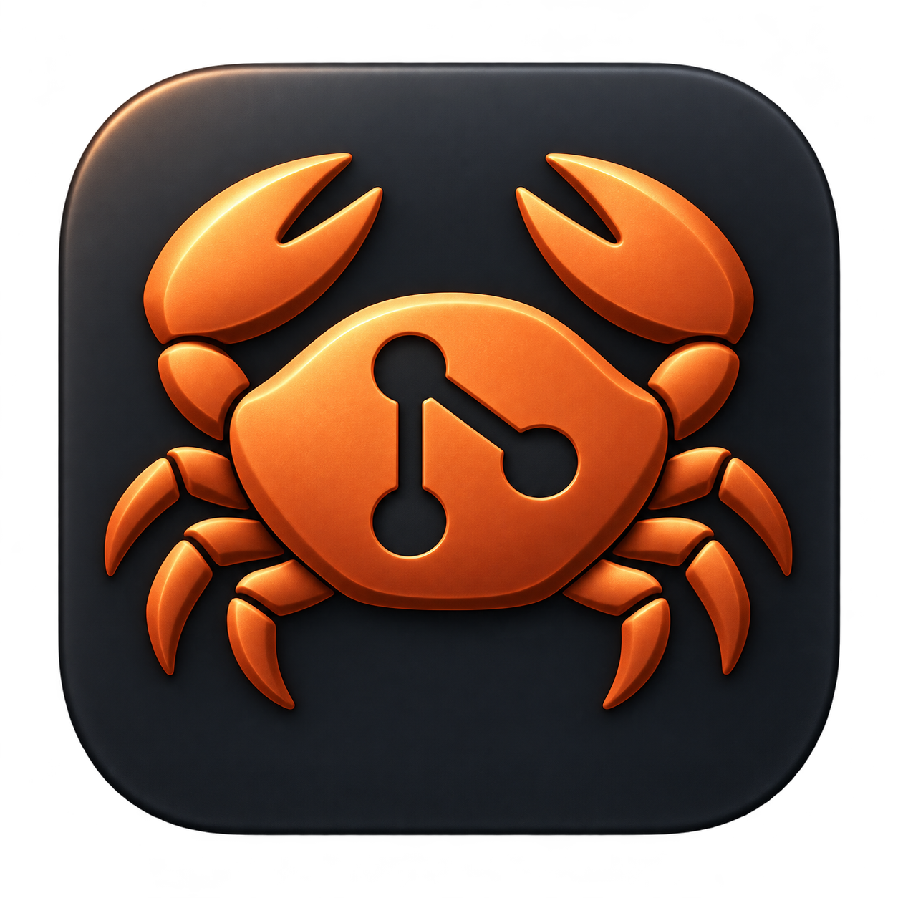

<p align="center"></p>

# RustGit

[English](README.en.md) · **简体中文**

在自己的电脑上保存项目版本，并在 macOS 和 Windows 之间共享。RustGit 提供桌面界面和 Rust 命令行引擎，可以由你自己的电脑托管项目，无需部署中心服务器。

> RustGit 使用独立的 `.rgit` 仓库格式，目前不兼容 Git 仓库协议，也不能直接推送到 GitHub。本 GitHub 仓库用于发布 RustGit 的源码和安装包。

## 下载安装

| 系统 | 下载 | 要求 |
| --- | --- | --- |
| macOS · Apple Silicon | [下载 DMG](https://github.com/xiezhengyi1/Rustgit/releases/download/v0.1.0/RustGit-0.1.0-macos-arm64.dmg) · [下载 ZIP](https://github.com/xiezhengyi1/Rustgit/releases/download/v0.1.0/RustGit-0.1.0-macos-arm64.zip) | macOS 14 或更新版本，M 系列芯片 |
| Windows · x64 | [下载安装程序 EXE](https://github.com/xiezhengyi1/Rustgit/releases/download/v0.1.0/RustGit-0.1.0-windows-x64-setup.exe) | Windows 10 1809 或更新版本、Windows 11 |

[全部 Release](https://github.com/xiezhengyi1/Rustgit/releases) · [SHA256 校验文件](https://github.com/xiezhengyi1/Rustgit/releases/download/v0.1.0/SHA256SUMS)

- **macOS：** 打开 DMG，将 RustGit 拖进“应用程序”。当前包未经 Apple 公证；若系统阻止打开，可在“系统设置 → 隐私与安全性”中确认来源后选择“仍要打开”。当前未提供 Intel Mac 桌面安装包。
- **Windows：** 运行 EXE，按提示安装。安装包未做代码签名，系统可能提示无法识别发布者。缺少 WebView2 时安装器会联网下载运行环境。

## 开始使用

### 只在本机保存版本

1. 在“项目”中新建项目，或打开已有文件夹并初始化。
2. 在“更改”中选择需要保存的文件，填写版本说明。
3. 点击“提交版本”。之后可在“历史与分支”中查看、比较或恢复文件。

左侧项目列表保留最近打开的项目，点击即可切换。

### 在两台电脑之间共享

1. **托管电脑：** 打开项目，在“共享”中选择托管此项目；让其他电脑连接时，开启局域网访问。
2. **托管电脑：** 创建有相应读写权限的邀请，将邀请链接私下发给另一台电脑。
3. **另一台电脑：** 在“项目”中使用邀请链接加入，选择文件夹，下载项目。
4. **修改之后：** 在“更改”中填写说明并点击 **“提交并共享”**，一次完成本地保存和发送。
5. **接收修改：** 在另一台电脑的“共享”中拉取并合并最新版本。

托管电脑需要保持唤醒且 RustGit 正在运行。首次连接时，两台电脑需要能够通过局域网或已配置的网络连接互通。互联网连接及自建中继见 [Iroh 文档](docs/relay.md)。

共享失败时，本地提交仍然保留；使用 **“重试共享”** 重新发送，无需再次提交。若别人已先更新共享分支，先拉取、处理合并，再共享。

## 能做什么

- **保存和恢复版本：** 按文件选择提交、查看差异、浏览历史、恢复文件和撤销提交。
- **分支协作：** 创建和切换分支、合并，以及处理冲突。
- **自己托管：** 加密连接、设备身份验证、一次性邀请、读写权限和撤销授权。
- **遵守忽略规则：** 自动读取项目内的 `.gitignore`，支持嵌套规则；可用 `.rgitignore` 添加专用规则。
- **减少重复存储：** 分块、去重及增量压缩，配有完整性检查和索引重建工具。
- **中英界面：** macOS 原生 SwiftUI，Windows 使用 Tauri、React 和 WebView2。

忽略规则适用于尚未跟踪的文件；已经提交的文件不会因为加入 `.gitignore` 就自动停止同步。`.git/` 和 `.rgit/` 始终排除。全局 Git 忽略规则和项目根目录之外的规则不读取。

## 当前版本与验证范围

`v0.1.0` 是早期版本。macOS Apple Silicon 桌面版已构建并运行；Windows x64 安装包已在实际 Windows 电脑上替换安装，并通过 UI“提交并共享”及第二副本拉取文件、校验哈希的测试。另验证了一个 3,425 文件、约 63 MB 的项目在 Windows 上完整落盘。

这不代表所有系统环境和功能都已验证。Windows 的失败重试、取消路径有自动化覆盖，尚未完成对应的原生手动测试。Windows 不支持还原符号链接；跨平台共享时应排除依赖缓存、构建产物和 macOS 应用包。详细范围见 [Windows 文档](docs/windows.md) 和 [实现状态](docs/status.md)。

## 从源码构建

### Rust 引擎与 CLI

基础引擎要求 Rust 1.89+；启用 Iroh 需要 Rust 1.91+。SQLite 随源码构建。

```bash
cargo build --release -p rustgit-cli --features iroh
cargo test --workspace
```

```bash
# 在项目目录中使用
rgit init
rgit config user.name "你的名字"
rgit status
rgit commit -m "第一个版本"
rgit log
```

共享、邀请和权限管理的 CLI 示例见 [CLI 使用说明](docs/cli.md)。

### macOS 桌面版

需要 macOS、Rust 和 Xcode Command Line Tools（或 Xcode），Swift 6+。

```bash
scripts/macos/build-app.sh
# 输出：dist/macos/ 下的 .app、.dmg 和 .zip
```

SDK 选择和测试方法见 [macOS 构建文档](docs/macos-app.md)。

### Windows 桌面版

在 Windows 上安装 Rust MSVC 工具链、Visual Studio 2022 C++ Build Tools 和 Node.js 20+，然后运行：

```powershell
.\scripts\windows\build.ps1
# 输出：dist\windows\ 下的 EXE、MSI 和校验文件
```

也提供 [macOS 交叉构建脚本](scripts/windows/build-cross.sh)。详细要求和签名说明见 [Windows 构建文档](docs/windows.md)。

## 项目结构与文档

| 路径 | 内容 |
| --- | --- |
| `crates/` | Rust 存储引擎、版本控制、CLI、同步和传输 |
| `apps/macos/` | macOS SwiftUI 桌面应用 |
| `apps/windows/` | Windows Tauri、React 桌面应用 |
| `packages/swift-client/` | Swift 与 CLI 的适配层 |
| `scripts/` | 构建、打包及校验脚本 |

[仓库格式与恢复](docs/format.md) · [同步协议](docs/protocol.md) · [SSH](docs/ssh.md) · [局域网发现](docs/discovery.md) · [存储基准](docs/benchmarks.md) · [设计决策](docs/decisions.md)
